# BoliTax — App del conductor

BoliTax es una aplicación móvil para **conductores de taxi**, inspirada en la versión de conductor de Uber. Está construida con React Native y Expo, y es el proyecto del curso de **Desarrollo Móvil**.

El conductor:
1. Se registra con sus datos, su vehículo y sus documentos.
2. Se pone **Disponible** y su ubicación se envía en tiempo real.
3. Recibe solicitudes de viaje con un temporizador de 15 segundos.
4. Navega hasta el pasajero y luego al destino.
5. Cobra el viaje con una pasarela de pagos en modo de prueba, o en efectivo.
6. Consulta sus ganancias y el historial de carreras.

> No hay app de pasajero: las solicitudes las crea un **simulador** del backend.

## Capturas de pantalla

<table>
  <tr>
    <td align="center"><br>Animación de inicio</td>
    <td align="center">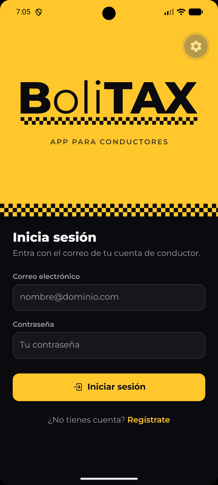<br>Inicio de sesión</td>
    <td align="center">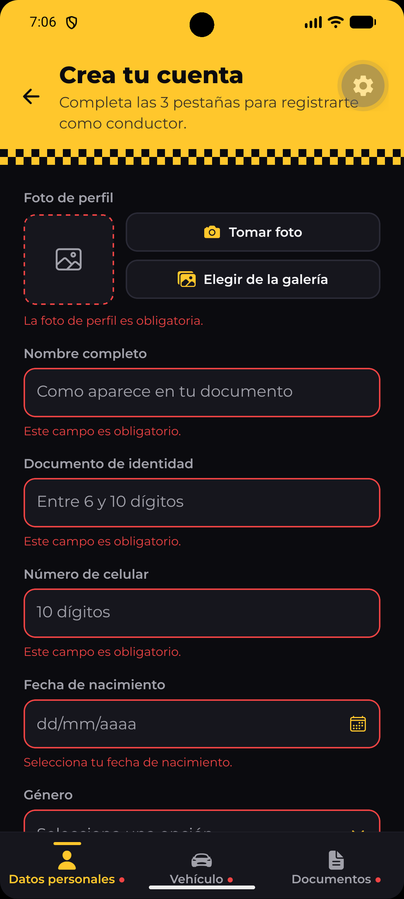<br>Registro</td>
  </tr>
  <tr>
    <td align="center">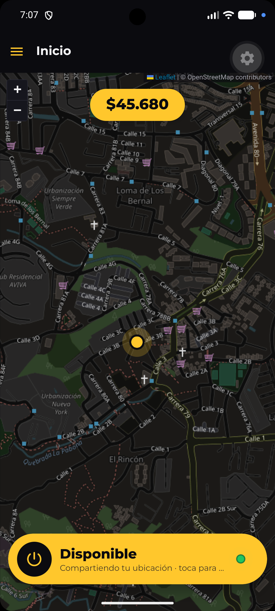<br>Inicio</td>
    <td align="center">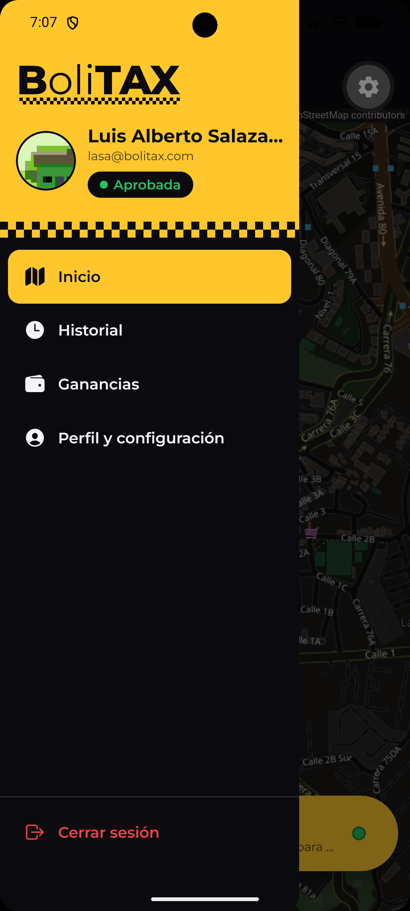<br>Menú lateral</td>
    <td align="center">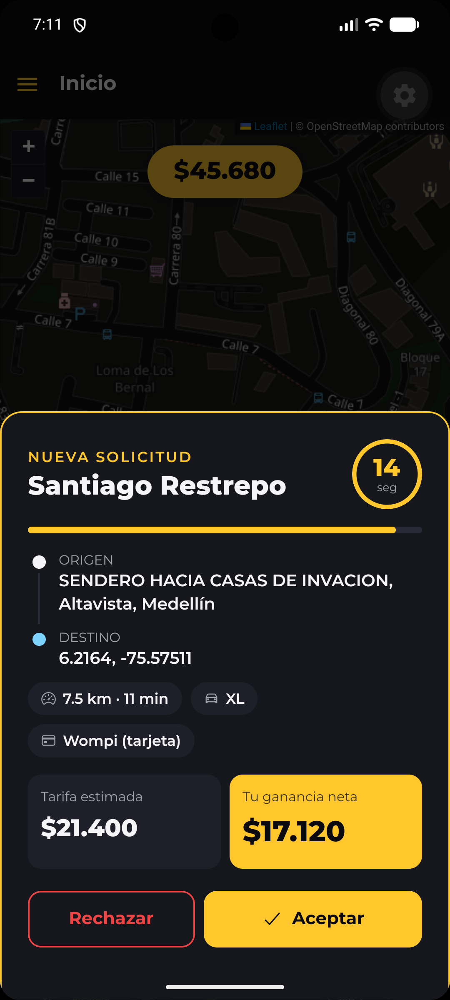<br>Solicitud entrante</td>
  </tr>
  <tr>
    <td align="center">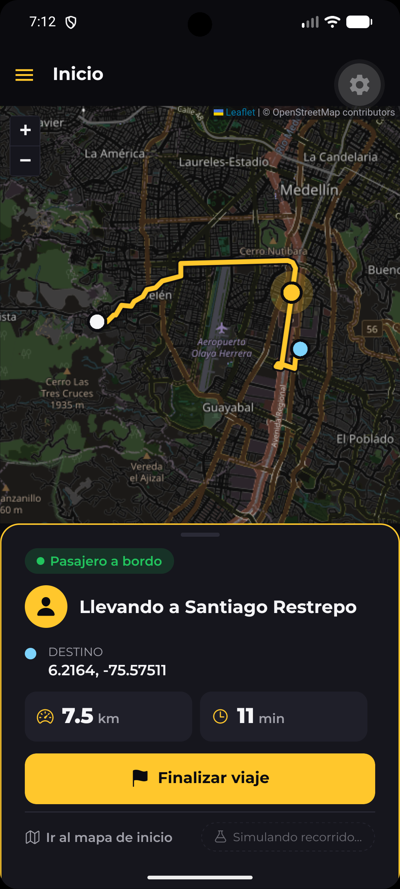<br>Viaje en curso</td>
    <td align="center">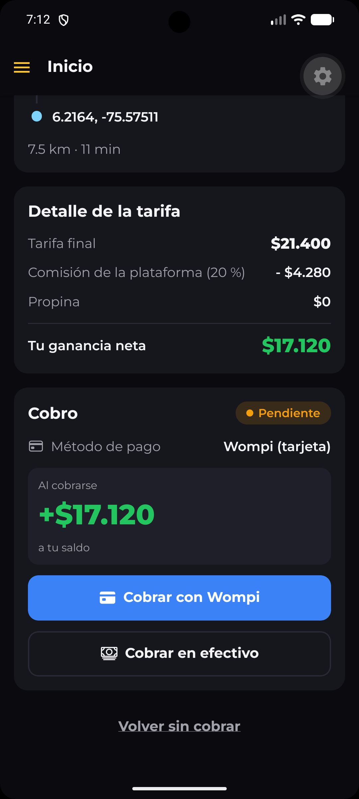<br>Resumen del viaje</td>
    <td align="center">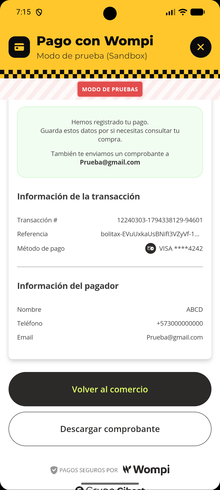<br>Pago con Wompi</td>
  </tr>
  <tr>
    <td align="center">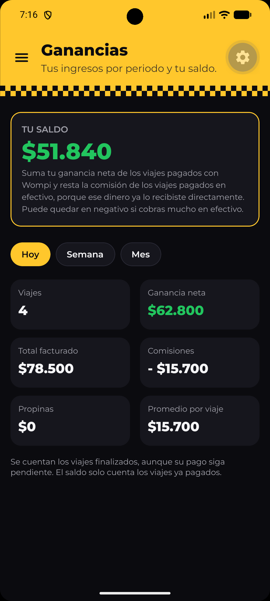<br>Ganancias</td>
    <td align="center">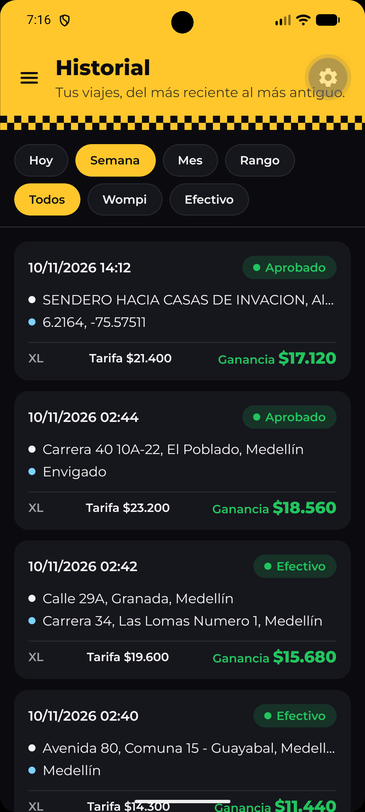<br>Historial</td>
    <td align="center">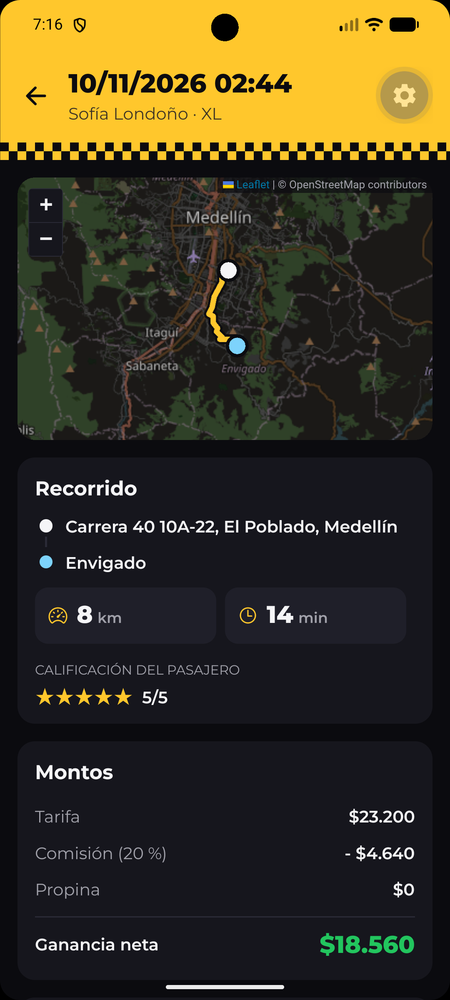<br>Detalle del viaje</td>
  </tr>
  <tr>
    <td align="center">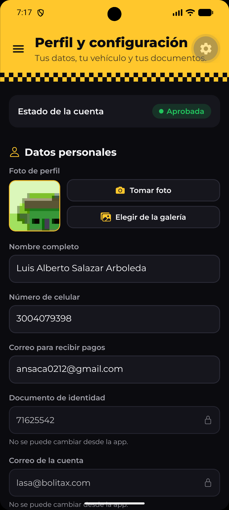<br>Perfil</td>
  </tr>
</table>

---

## Funcionalidades

- **Animación de inicio:** el taxi entra y frena bajo el logotipo de BoliTax. Es un extra propio, sin parpadeo entre la splash nativa y la animación.
- **Registro en 3 pestañas:** datos personales, vehículo, y documentos y pagos.
  - Validaciones en cada campo y errores debajo del campo, nunca en un Alert.
  - Fotos con cámara o galería, subidas a Cloudinary.
  - La cuenta queda **pendiente de aprobación**.
- **Inicio:**
  - Mapa de OpenStreetMap en modo oscuro (filtro CSS sobre los tiles) con la ubicación actual.
  - Botón principal **Disponible / No disponible**, que solo se puede activar si la cuenta está aprobada.
  - Envío de la ubicación a Firestore como máximo una vez cada 5 s.
  - Óvalo con la ganancia neta de hoy; al tocarlo abre Ganancias.
- **Solicitudes de viaje en tiempo real:**
  - Modal con origen, destino, distancia, duración, categoría, método de pago, tarifa y ganancia neta.
  - Temporizador de 15 s; si llega a cero, la solicitud se rechaza sola.
  - Sonido y notificación push (FCM), también con la app en segundo plano o cerrada.
- **Viaje en curso:**
  - Ruta OSRM hacia el punto de recogida y, con el pasajero a bordo, hacia el destino.
  - Cancelación antes de recoger al pasajero.
  - **Modo demo** para simular el recorrido.
- **Cobro y resumen:**
  - Tarifa final, comisión del 20 % y ganancia neta.
  - Pago con **Wompi** (Sandbox) en un WebView, o **en efectivo**.
  - Estado del pago en tiempo real y efecto del viaje en el saldo.
- **Ganancias:** totales de hoy, la semana y el mes (viajes, facturado, comisiones, propinas, ganancia neta y promedio) y el **saldo** del conductor.
- **Historial de carreras:**
  - Filtros Hoy, Semana, Mes y Rango de fechas, y por método de pago.
  - Paginación de 20 viajes.
  - Detalle con la ruta guardada dibujada en el mapa y la calificación del pasajero.
  - Desde el detalle se puede cobrar un viaje que quedó con el pago pendiente.
- **Perfil y configuración:**
  - Datos editables con las mismas validaciones del registro.
  - Vehículo, y documentos con alerta si están vencidos o vencen en 30 días.
  - Idioma Español / English.
  - Cierre de sesión.

---

## Stack y decisiones

| Necesidad | Tecnología | Por qué |
|---|---|---|
| App | **Expo SDK 58** (React Native 0.88, JavaScript) con *development build* | Usa módulos nativos (Firebase, mapas, notificaciones, sonido), así que no se puede usar Expo Go. |
| Navegación | **React Navigation**: Stack (viaje e historial), Tabs (registro) y Drawer (secciones) | Es la navegación combinada que pide el enunciado. |
| Autenticación y datos | **Firebase Auth + Firestore** con `@react-native-firebase` | Cloud Messaging (notificaciones push) necesita módulos nativos. Con la misma librería se usan Auth y Firestore, y `onSnapshot` da el tiempo real. |
| Mapa | **Leaflet + tiles de OpenStreetMap** dentro de `react-native-webview` | No requiere API key ni facturación de Google Cloud. El WebView está versionado por Expo y también sirve para el checkout de pagos. |
| Rutas, distancia y duración | **OSRM** (servidor público) | Reemplazo gratuito de Directions / Distance Matrix. |
| Coordenadas a dirección | **Nominatim** (OpenStreetMap) | Gratuito. Se respeta su límite de 1 petición por segundo y se envía un User-Agent propio. |
| Ubicación | `expo-location` | Permiso en primer plano y `watchPositionAsync`. |
| Pagos | **Wompi** (Bancolombia), Web Checkout en **Sandbox** | Pasarela colombiana con llaves y tarjetas de prueba reales. Cumple el mismo flujo obligatorio que Mercado Pago, que es la que recomienda el enunciado. |
| Imágenes | **Cloudinary** (upload preset sin firma) | Firebase Storage puede exigir el plan de pago; Cloudinary tiene un plan gratuito. |
| Notificaciones | **Firebase Cloud Messaging** + `expo-notifications` (canal de Android con sonido) | Es obligatorio según el enunciado. |
| Backend | **Node.js + Express + firebase-admin** | Crea los cobros con las llaves secretas de Wompi y verifica los pagos. Incluye el simulador de pasajeros. |
| Pruebas | **Jest** (app) y `node --test` (backend) | La lógica pura (tarifas, saldo, filtros, transiciones, etc.) está separada en funciones con pruebas. |

**Una sola fuente de verdad:** el backend importa directamente las funciones de la app, así la tarifa y las reglas son las mismas en ambos lados:
- `calculateFare` y la configuración de tarifas.
- Los parsers de rutas.
- Las transiciones de estado del viaje.
- La calificación simulada del pasajero.

---

## Requisitos previos

- **Node.js 22 o superior** (se desarrolló con Node 24).
- **JDK 17** (por ejemplo, Eclipse Adoptium).
- **Android Studio** con el SDK de Android y un **emulador con Google Play**. La imagen debe decir "Google Play" o "Google APIs": sin Google Play Services no funcionan las notificaciones push.
- Una cuenta de **Firebase**, una de **Cloudinary** y una de **Wompi** (Sandbox).

> ⚠️ **Windows y rutas largas:** la compilación nativa (ninja/CMake) falla si la ruta del proyecto es muy larga. Clona el proyecto en una ruta corta, por ejemplo `C:\dev\bolitax`.

---

## Instalación y ejecución

### 1. Clonar e instalar

```bash
git clone https://github.com/andres-sc-dev/BoliTax.git C:\dev\bolitax
cd C:\dev\bolitax
npm install
cd backend
npm install
cd ..
```

### 2. Archivos y variables que debes agregar (no están en Git)

| Archivo | Dónde | Qué es |
|---|---|---|
| `google-services.json` | raíz del proyecto | Configuración de la app Android de Firebase. |
| `backend/serviceAccountKey.json` | carpeta `backend/` | Llave de servicio de Firebase para el backend. |
| `.env` | raíz del proyecto | Copia de [`.env.example`](.env.example) con tus valores. |
| `backend/.env` | carpeta `backend/` | Copia de [`backend/.env.example`](backend/.env.example) con tus valores. |

**Variables de la app** ([`.env.example`](.env.example)). No contienen secretos y van dentro de la app:

| Variable | Descripción |
|---|---|
| `EXPO_PUBLIC_CLOUDINARY_CLOUD_NAME` | Nombre de tu cuenta de Cloudinary. |
| `EXPO_PUBLIC_CLOUDINARY_UPLOAD_PRESET` | Nombre del upload preset **sin firma**. |
| `EXPO_PUBLIC_API_URL` | URL del backend. En el emulador de Android es `http://10.0.2.2:3000` (10.0.2.2 es el localhost del PC). |

**Variables del backend** ([`backend/.env.example`](backend/.env.example)). Son **secretos**: solo van en `backend/.env`:

| Variable | Descripción |
|---|---|
| `PORT` | Puerto del servidor (por defecto `3000`). |
| `FIREBASE_SERVICE_ACCOUNT_PATH` | Ruta a la llave de servicio (por defecto `./serviceAccountKey.json`). |
| `WOMPI_PUBLIC_KEY` | Llave pública de Sandbox (`pub_test_...`). |
| `WOMPI_PRIVATE_KEY` | Llave privada de Sandbox (`prv_test_...`). Solo se usa para consultar transacciones. |
| `WOMPI_INTEGRITY_SECRET` | Secreto de integridad (`test_integrity_...`). Sirve para firmar cada cobro. |
| `WOMPI_API_URL` | `https://sandbox.wompi.co/v1` |

> Nunca subas los `.env` reales ni las llaves: ya están en `.gitignore`.

### 3. Ejecutar

En **tres terminales**:

```bash
# 1) Backend (API de pagos)
cd backend
npm run dev          # http://localhost:3000/health debe responder {"status":"ok"}

# 2) App: la primera vez compila e instala el development build en el emulador
npx expo run:android
#    las siguientes veces basta con:
npx expo start -c    # -c limpia la caché (necesario si cambias el .env)

# 3) Simulador de pasajeros: crea una solicitud para el conductor Disponible
cd backend
npm run simulate                                   # categoría del vehículo y pago aleatorio
npm run simulate -- --payment=wompi                # o --payment=cash
npm run simulate -- --category=xl --payment=cash   # categorías: economy, xl, premium
```

> El simulador busca un conductor con `isAvailable: true` y `status: "approved"`. Para aprobar la cuenta después del registro, cambia a mano `drivers/{uid}.status` a `"approved"` en la consola de Firestore. La aprobación la hace un administrador.

En el emulador, pon una ubicación en Medellín desde **⋯ (Extended controls) → Location → Set location**.

---

## Configuración de servicios

### Firebase
1. Crea un proyecto en [Firebase Console](https://console.firebase.google.com).
2. Agrega una **app Android** con el paquete `com.andressc.bolitax`, descarga `google-services.json` y ponlo en la raíz del proyecto.
3. En **Authentication**, activa el proveedor **Correo electrónico/contraseña**.
4. Crea la base de datos de **Firestore**.
5. **Reglas de seguridad:** en Firestore → **Reglas**, pega el contenido de [`firestore.rules`](firestore.rules) y publica.
6. **Índices compuestos del historial:** créalos con el enlace que aparece en la terminal de Metro la primera vez que filtras el historial, o a mano en Firestore → Índices con los campos de [`firestore.indexes.json`](firestore.indexes.json).
7. **Llave de servicio:** en Configuración del proyecto → Cuentas de servicio → *Generar nueva clave privada*. Guárdala como `backend/serviceAccountKey.json`.
8. **Cloud Messaging** viene activo por defecto. La app guarda su token en `drivers/{uid}.fcmToken`.

### Cloudinary
1. Crea una cuenta gratuita en [cloudinary.com](https://cloudinary.com).
2. En Settings → **Upload**, crea un **upload preset** de tipo **Unsigned**.
3. Pon el *cloud name* y el nombre del preset en el `.env` de la app. La app no usa el API secret.

### Wompi (Sandbox)
1. Crea una cuenta en el [panel de comercios de Wompi](https://comercios.wompi.co) y usa el **ambiente Sandbox**.
2. Copia las llaves de prueba (pública, privada y de integridad) en `backend/.env`.
3. **Tarjetas de prueba** (cualquier fecha futura y cualquier CVC):

| Número | Resultado |
|---|---|
| `4242 4242 4242 4242` | Aprobada |
| `4111 1111 1111 1111` | Rechazada |

**Flujo de pago**, el obligatorio de la sección 4 del enunciado:
1. La app envía el `tripId` al backend.
2. El backend lee el monto **del viaje en Firestore**, firma el cobro con el secreto de integridad y devuelve la URL del Web Checkout.
3. El pasajero paga en el WebView.
4. El backend **consulta la transacción a Wompi** con la llave privada. Nunca se confía en la redirección.
5. El backend actualiza el viaje (`paymentStatus`, `paymentId`, `status: paid`).
6. La app ve el cambio en tiempo real.

---

## Estructura del proyecto

```
bolitax/
├── App.js                  # proveedores, navegación y animación de inicio
├── index.js                # manejador de mensajes FCM en segundo plano
├── app.json                # configuración de Expo y config plugins
├── assets/                 # íconos, splash y sonido de nuevas solicitudes
├── src/
│   ├── components/         # mapa (LeafletMap), modal de solicitud, panel de cobro, campos de formulario…
│   │   └── brand/          # logo, logotipo y taxi de la animación (PNG de `npm run brand:assets`)
│   ├── config/             # tarifas (pricing.js), opciones del registro y etiquetas
│   ├── context/            # sesión, disponibilidad, viaje activo, ganancias, idioma y registro
│   ├── hooks/              # useDriverLocation, useTripRequests, useEarnings, useTripHistory…
│   ├── i18n/               # diccionario propio Español / English
│   ├── navigation/         # Drawer, Stacks y Tabs
│   ├── screens/            # pantallas (auth/, register/, inicio, viaje, resumen, ganancias…)
│   ├── services/           # Firebase (único punto de acceso), Cloudinary, rutas, pagos, viajes…
│   └── utils/              # funciones puras con pruebas (calculateFare, saldo, filtros…)
├── backend/
│   ├── src/                # Express: /health y /payments/wompi/*, firebase-admin, Wompi
│   └── scripts/            # simulatePassenger.js
├── docs/
│   ├── AI_LOG.md           # bitácora de uso de IA
│   └── requisitos-bolitax.pdf
├── firestore.rules         # reglas de seguridad de Firestore
└── firestore.indexes.json  # índices compuestos del historial
```

---

## Pruebas

```bash
npm test              # app: Jest (tarifas, validaciones, saldo, filtros, transiciones, etc.)
cd backend
npm test              # backend: node --test (firma de Wompi, estados y validación de transacciones)
```

La lógica pura está separada de las pantallas en `src/utils/` (y en `backend/src/wompi.js`) para poder probarla sin emulador.

## Modo demo

En *development build* (`__DEV__`), la pantalla **Viaje en curso** tiene el botón **"Simular recorrido (demo)"**:
- Mueve la ubicación del conductor por la ruta actual en unos 12 segundos, hasta la recogida o hasta el destino.
- La ubicación simulada se guarda en Firestore respetando el mismo límite de escrituras.
- Si cambia el estado del viaje o sales de la pantalla, vuelve el GPS real.

Este botón no existe en una build de producción.

---

## Uso de IA

En este proyecto se usó inteligencia artificial generativa, con autorización del curso:

- **Claude (chat en claude.ai):** planeación del proyecto, explicaciones y revisión de los prompts.
- **Claude Code (agente en VS Code):** generación de código, siempre con un plan aprobado antes de escribir. Cada fase se revisó, se probó en el emulador y se registró en la bitácora.

Toda interacción está documentada en la **[bitácora de IA (docs/AI_LOG.md)](docs/AI_LOG.md)**. Cada entrada incluye:
- El prompt literal.
- Un resumen de la respuesta.
- Qué se usó, qué se modificó y qué se descartó.
- Los archivos y el commit.
- Cómo se verificó.
- Lo aprendido.

En el código, los bloques asistidos por IA están marcados con el comentario `// AI-assisted: see docs/AI_LOG.md #N`, que remite a su entrada.
